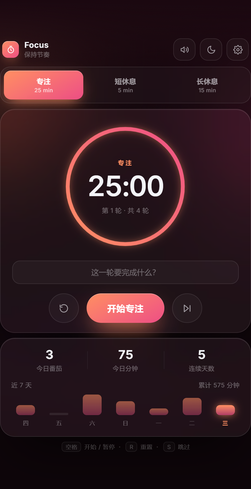
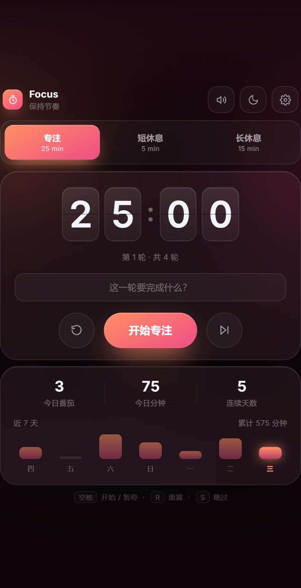
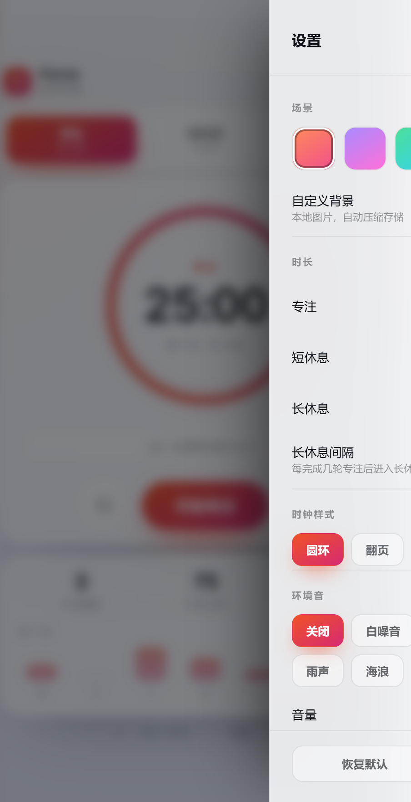

# Focus · 番茄钟

一个单文件的番茄工作法计时器。**零依赖、零构建、可离线运行**——双击 `index.html` 即可使用。

[]() []() []()

<p align="center">
  
  
  
</p>

## 功能

**计时核心**
- 专注 25 / 短休 5 / 长休 15 分钟，时长可自由调整
- 每完成 N 轮专注自动进入长休息（N 可配置）
- 基于时间戳计时，关闭标签页再回来也能自动校正，不受后台节流影响
- 自动开始下一阶段（可开关）

**两种时钟样式**
- **圆环**：SVG 渐变描边 + 模糊光晕双层结构
- **翻页**：真实 CSS 3D 翻页动画（上页翻落 → 下页揭开）

**六套动态场景**

落日 / 星夜 / 极光 / 深海 / 森林 / 极简。每套由三个缓慢漂移的光斑、顶部光束和 SVG 噪点颗粒层合成，切换时平滑过渡。深浅主题各自配有一套独立的高对比调色板。

**环境音（纯代码合成）**

白噪音 / 粉噪音 / 棕噪音 / 雨声 / 海浪——全部由 Web Audio API 实时生成，**不加载任何音频文件**。五种噪声经 RMS 归一化，响度极差控制在 0.19 dB 以内，切换类型时不会有音量跳变。

**其他**
- 自定义背景：上传本地图片，自动压缩存储
- 统计：今日番茄数 / 专注分钟 / 连续天数 + 近 7 天柱状图
- 键盘快捷键：`空格` 开始暂停、`R` 重置、`S` 跳过、`Esc` 关闭设置
- 页面标题同步倒计时
- 窗口化自适应：所有尺寸由视口高度驱动，非全屏也完整显示

## 使用

```bash
git clone https://github.com/<你的用户名>/pomodoro-timer.git
cd pomodoro-timer
# 直接用浏览器打开
start index.html      # Windows
open index.html       # macOS
```

或直接在线访问（GitHub Pages）：`https://<你的用户名>.github.io/pomodoro-timer/`

## 技术说明

| 项目 | 说明 |
|------|------|
| 技术栈 | 原生 HTML + CSS + JavaScript |
| 依赖 | 无 |
| 构建 | 无需构建 |
| 数据存储 | localStorage（仅本地，无网络请求） |
| 浏览器 | Chrome / Edge 105+、Firefox 110+、Safari 16+ |

**实现要点**

- **计时精度**：用 `endAt` 时间戳配合 `setInterval` 计算剩余时间，而非累加计数，避免定时器漂移和后台标签页节流导致的误差。
- **翻页动画**：`rotateX` 双段翻转，上页 `0° → -90°`、下页 `90° → 0°`，中间用 `animation-fill-mode: backwards` 解决延迟阶段的闪现问题。
- **噪声归一化**：白/粉/棕三种噪声的能量分布差异极大（棕噪音 RMS 仅为白噪音的 1/3），在生成缓冲区时统一归一化到目标电平，再对滤波链单独补偿。
- **自适应布局**：全站尺寸由视口高度驱动的 `clamp()` 变量体系控制（圆环、留白、字号、按钮联动缩放）；居中采用 `.app { margin: auto }`，避免内容溢出时顶部被推出视口。
- **分段控件**：滑块位置由 `getBoundingClientRect()` 实测定位，而非 CSS 百分比计算，保证不同字号下零偏差。

## 快捷键

| 按键 | 功能 |
|------|------|
| `空格` | 开始 / 暂停 |
| `R` | 重置当前阶段 |
| `S` | 跳过当前阶段 |
| `Esc` | 关闭设置面板 |

## 数据说明

所有数据仅保存在浏览器 localStorage 中，不会上传到任何服务器。清除统计数据可在设置面板底部操作。

| 键名 | 内容 |
|------|------|
| `focus_cfg_v3` | 全部设置项 |
| `focus_stats_v3` | 按日期的专注记录 |
| `focus_task_v3` | 当前任务描述 |

## License

[MIT](LICENSE)
